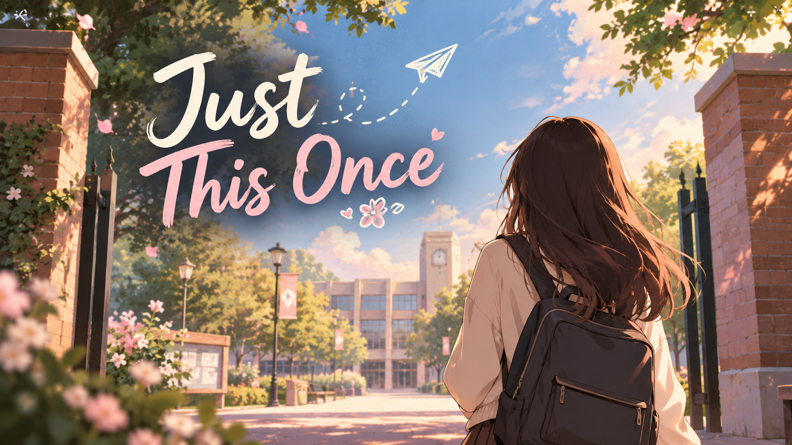
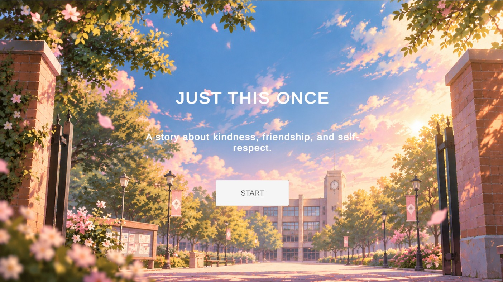
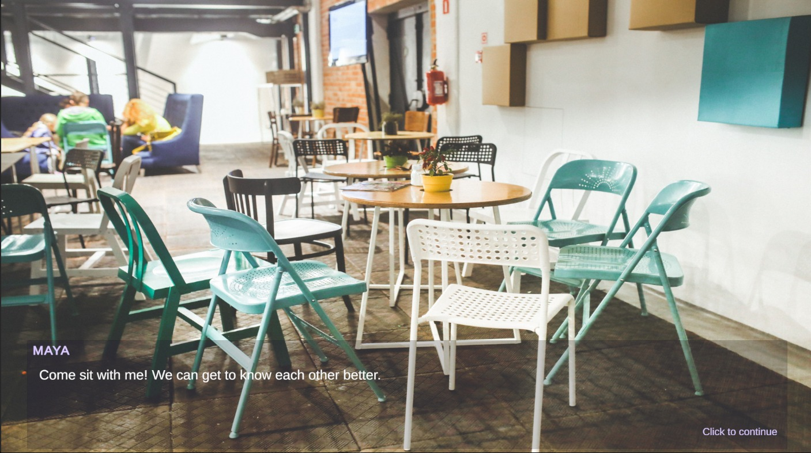
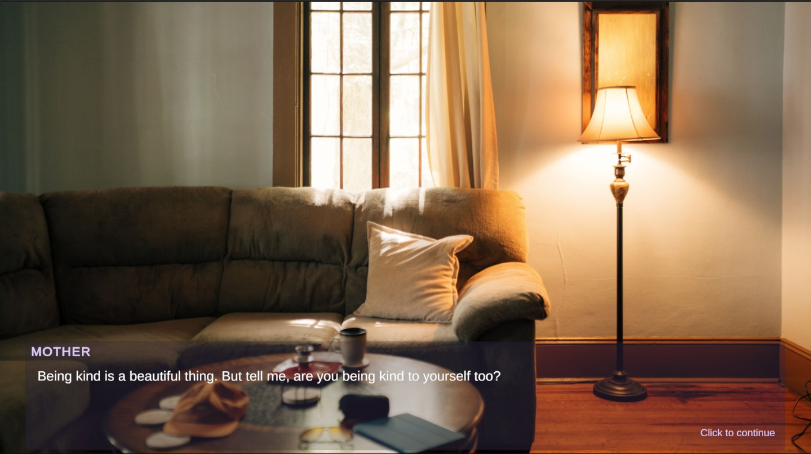
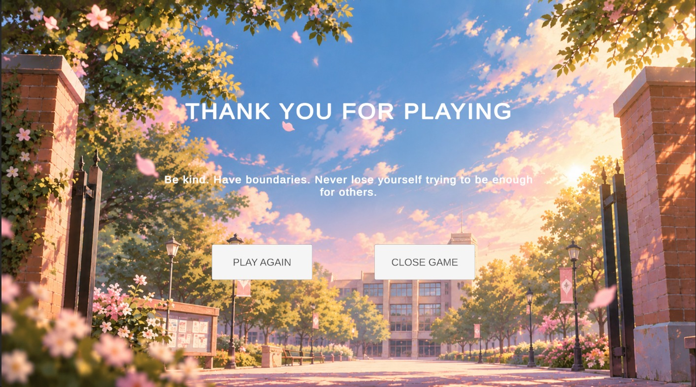

# 🎮 Just This Once

*A 2D visual novel about kindness, boundaries, and self-respect.*

## 📖 About the Game

**Just This Once** is my first-ever 2D game, developed solo using **Unity 6.3 LTS** for **Women Game Jam 2026**, based on the theme **"Learn to Say No."**

The game follows a college student who believes that being kind is enough to build meaningful friendships. Over time, she realizes that some people take advantage of her kindness and that she needs to set boundaries and stand up for herself.

Through its story, the game explores an important message:

> You don't have to become less kind to earn respect. You just have to remember that you deserve it, too.

## ✨ Features

- 📚 Narrative-driven visual novel experience
- 🏫 Multiple backgrounds, including a college campus, classroom, cafeteria, and home
- 💬 Dialogue-based storytelling
- 🖥️ Start screen, gameplay interface, and end screen
- 💜 A story centered on kindness, self-respect, and personal boundaries

## 🖼️ Screenshots

### Start Screen

### Cafeteria Scene

### Home Scene

### End Screen

## 🛠️ Built With

- **Engine:** Unity 6.3 LTS
- **Programming Language:** C#
- **Game Type:** 2D Visual Novel
- **Development:** Solo project

## 🎮 Play the Game

Play the Windows build on itch.io:

👉 [Play Just This Once](https://khushbu.itch.io/just-this-once)

## 🚀 How to Run the Project

To explore or run the project in Unity:

1. Clone or download this repository.
2. Open **Unity Hub**.
3. Select **Add project from disk** and choose the downloaded project folder.
4. Open the project using a compatible Unity version.
5. Open the main scene at `Assets/Scenes/MainMenu.unity`.
6. Press **Play** in the Unity Editor.

Allow Unity to import the assets and packages when opening the project for the first time.

## 🌱 What I Learned

Building my first game gave me hands-on experience with:

- Creating a 2D game using Unity.
- Writing C# scripts to manage dialogue and story progression.
- Switching backgrounds based on the story.
- Building UI screens and connecting buttons to game logic.
- Turning a story idea into a complete, playable experience.

This project marks the beginning of my journey into game development, and I'm excited to keep learning and building more interactive experiences.

## 🙌 Credits

- Background assets and other resources: See the relevant asset sources and licenses.
- Unity and its associated tools: Used for game development.

*Please refer to the original asset sources and licenses for attribution requirements.*

## 👩‍💻 Developer

**Khushbu Patel**

- [GitHub](https://github.com/Khushbu696)
- [Portfolio](https://khushbu-patel-portfolio.netlify.app/)
- [itch.io](https://khushbu.itch.io/just-this-once)

---

*Created for Women Game Jam 2026. My first step into game development.* 💜